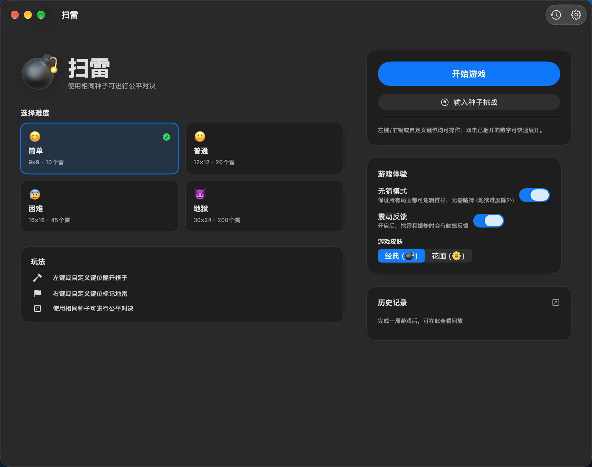
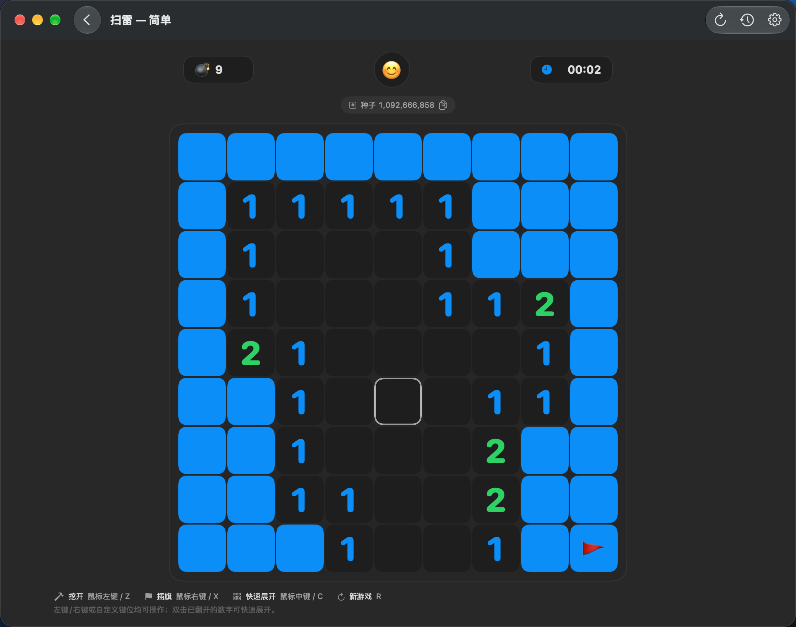
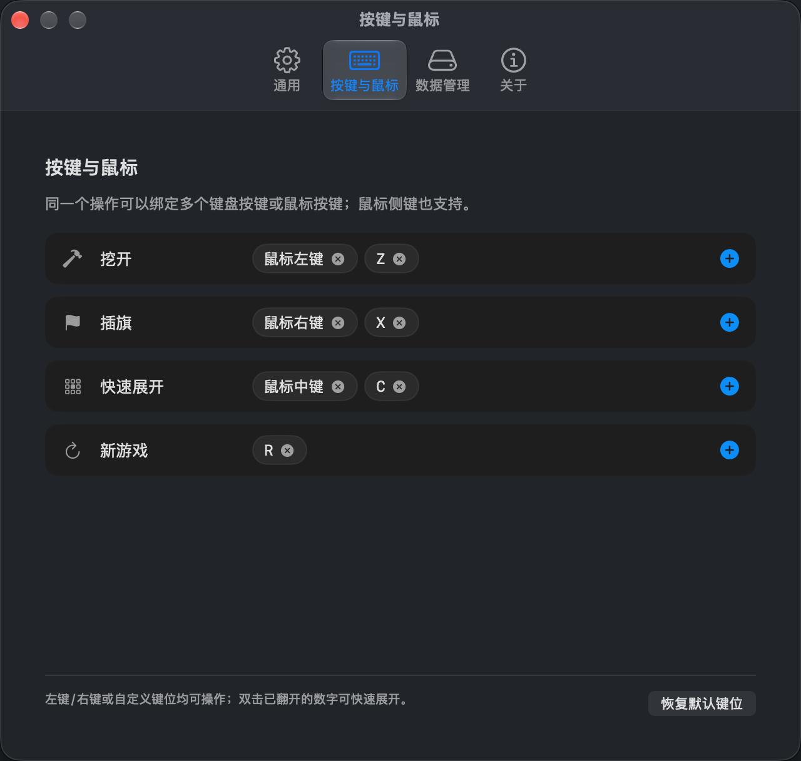

# Minesweeper (iOS + macOS)


一个 SwiftUI + Rust 的扫雷游戏，同时提供 iOS/iPadOS 与原生 macOS 两个前端。所有游戏规则、棋盘生成、无猜求解、操作判定、回放和历史合并都在 Rust 里；Swift 只负责 SwiftUI 渲染和平台适配（震动、计时、UserDefaults、iCloud、剪贴板、鼠标键盘）。

macOS 版不是 Catalyst，也不是“Designed for iPad”：它使用独立的 AppKit/SwiftUI 窗口、菜单栏、设置场景和鼠标事件处理，与 iOS target 共享同一套 Rust 核心和 Swift 游戏逻辑。

## ✨ 核心亮点

- **Rust 核心**：棋盘、RNG、布雷、洪水填充、双击、胜负判定、回放、历史排序/合并/序列化全部由 Rust 实现。
- **UniFFI 绑定**：一份 Rust API 自动生成 Swift（未来也可生成 Kotlin）绑定，模型无需两边手抄。
- **无猜模式**：生成器用队列式约束传播求解器验证局面，避免需要二选一的死局。
- **种子系统**：同一种子 + 相同首点生成同一棋盘（首点不同会改变安全区，因此棋盘也不同）；种子由时间、纳秒和电量混合而成。
- **涟漪式开区与连锁爆炸**：Rust 输出展开波次和延迟时间轴，Swift 只负责播放动画。
- **完整回放**：每一步可拖拽跳转；跳转是一次同步 Rust 调用，不会残留上一位置的延迟回调。
- **多语言**：简体中文、繁體中文、English、日本語，共 4 种。
- **双皮肤**：经典 💣 与花圃 🌼。
- **iPhone Duo**：已适配折叠/展开两种屏幕。合上时（466×678pt）内容可滚动，展开时（669×951pt）使用双栏布局；棋盘按可用空间自动缩放，支持展开/合上的尺寸变化与横屏。
- **原生 macOS**：可缩放窗口、菜单栏（⌘N 新局、⌘1–⌘4 难度、⌘Y 历史、⌘, 设置）、悬停高亮、右键插旗、双击快速展开、触控板触感反馈。
- **可自定义键位**：挖开/插旗/快速展开/新游戏都可以绑定多个键盘按键或鼠标按键；支持鼠标侧键（后退/前进）、任意组合键和鼠标中键，冲突的按键会自动从旧操作移走。左键与 Z 同义，右键与 X 同义。
- **iCloud 历史**：基于 `NSUbiquitousKeyValueStore`；历史 JSON 用 `MSH1` + zlib 压缩（50 条地狱记录约 2MB → 约 255KB），上传前先 merge 云端，避免后写覆盖先写；删除用 tombstone（保留 90 天）、清空用 `clearedAt` 传播，空云端数据不会再误清本地；压缩/写盘在后台串行队列执行。需要自行配置 iCloud Key-Value Storage 能力。

### 🖥️ macOS 原生界面







## 🧱 架构

```
Rust/src (游戏规则、无猜求解、回放、历史合并)
        ↓ UniFFI
Shared/  (Rust 绑定、模型、ViewModels、历史/云同步/本地化、CellView、
          BoardMetrics、InputBinding)
        ├── Minesweeper/      iOS/iPadOS target：NavigationStack、UIScrollView 缩放、
        │                     UIKit 手势覆盖层、Taptic Engine
        └── MinesweeperMac/   原生 macOS target：WindowGroup + Settings + Window、
                              AppKit 鼠标覆盖层、NSEvent 键盘监听、Canvas 棋盘

Haptics / Timer / UserDefaults / iCloud KVS / Pasteboard
```

### 性能取舍

- 快照使用扁平数组（`cellFlags: Data`、`neighborCounts: Data`、`revealDelaysMs`），一次动作只有少量分配，不做逐格 FFI。
- 求解器使用每格 `unknown` / `mines_around` 计数 + 工作队列，而不是反复扫描全部已知安全格。
- 布雷使用部分 Fisher–Yates，避免雷数多时拒绝采样退化。
- `GameHeaderView` 单独观察 `GameClock`，计时 tick 不会再让 720 格棋盘参与 diff。
- `MinesweeperGame` 用单一 `GameBoardState` 原子发布，减少一次操作内的 `objectWillChange`。
- 计时器用真实时间差（`Date` delta）并监听 `scenePhase`，后台暂停、回前台恢复，避免 Task 延迟导致计时漂移。
- 小棋盘继续用 `CellView`；超过 300 格的 iOS 大棋盘（地狱 30×24）自动切换为单个 `Canvas` + 一个手势覆盖层 + `TimelineView` 批量动画。
- 大棋盘按可用空间预缩放，初始 1:1 交给 UIScrollView，保留用户自己的缩放/拖拽。
- 去掉了每格 shadow；结算时改用轻量 dim 层，不再对整棵 720 格视图树做实时 blur。
- `CellView` 去掉了每格的 `GeometryReader`，用固定尺寸计算字号；`Cell` 不再每帧生成 UUID。
- 实测（Release，Mac，同机；`cargo run --release --example bench`）：

| 难度 | 首次点击平均 | 最差 |
|---|---:|---:|
| 简单 9×9 / 10 雷 | 0.006 ms | 0.026 ms |
| 普通 12×12 / 20 雷 | 0.011 ms | 0.057 ms |
| 困难 16×16 / 45 雷 | 0.066 ms | 0.279 ms |

这是无猜模式开启、最多 2000 次重试路径下的数据；UI 渲染才是主要开销，核心计算已经不是瓶颈。

## 🎮 难度

- 😊 简单：9×9 · 10 雷
- 😐 普通：12×12 · 20 雷
- 😰 困难：16×16 · 45 雷
- 😈 地狱：30×24 · 200 雷（长按主页大图标 5 秒）

## 🛠️ 开发环境

- Xcode 16+（项目使用 filesystem-synchronized groups）；当前验证使用 Xcode 27 + iOS 27 模拟器 + macOS 27 SDK。
- 共享代码放在 `Shared/`，两个 target 都引用它；`Minesweeper/` 只保留 iOS 专属代码，`MinesweeperMac/` 只保留 macOS 专属代码。
- Rust 版本由 `rust-toolchain.toml` 固定为 1.98.0，并启用 `clippy` / `rustfmt`、声明 iOS targets。CI（`.github/workflows/ci.yml`）会跑 fmt、clippy、测试和 iOS 构建。已安装 iOS target：
  ```bash
  rustup target add aarch64-apple-ios aarch64-apple-ios-sim x86_64-apple-ios
  rustup target add aarch64-apple-darwin x86_64-apple-darwin
  ```
- 首次构建或修改 Rust FFI 接口后，重新生成 Swift 绑定：
  ```bash
  ./Rust/generate-bindings.sh
  ```
  该脚本会更新：
  - `Minesweeper/Core/Generated/minesweeper_core.swift`
  - `Rust/include/minesweeper_coreFFI.h`
  - `Rust/include/module.modulemap`
- 正常 Xcode 构建由两个 target 的 **Build Rust core** Run Script 自动执行 `Rust/build-ios.sh`，按 `PLATFORM_NAME` 产出 `Rust/libs/iphoneos`、`Rust/libs/iphonesimulator` 和 `Rust/libs/macosx` 的静态库；macOS 库是 arm64 + x86_64 的 universal 二进制。
- 该 target 已设置 `ENABLE_USER_SCRIPT_SANDBOXING = NO`，否则 Xcode 的脚本沙箱会阻止 cargo 访问 `~/.cargo`。
- 直接跑通 Rust 测试：
  ```bash
  cargo test --manifest-path Rust/Cargo.toml --lib
  cargo run --manifest-path Rust/Cargo.toml --release --example bench
  ```
- 跑 Swift 单元测试（HistoryCodec / BoardMetrics / Localization / InputBindings）：
  ```bash
  xcodebuild test -project Minesweeper.xcodeproj -scheme Minesweeper \
    -destination 'platform=iOS Simulator,name=iPhone 18 Pro'
  ```
- 构建 / 运行 macOS 版：
  ```bash
  xcodebuild build -project Minesweeper.xcodeproj -scheme MinesweeperMac \
    -destination 'platform=macOS' CODE_SIGNING_ALLOWED=NO
  open ~/Library/Developer/Xcode/DerivedData/Minesweeper-*/Build/Products/Debug/MinesweeperMac.app
  ```
  也可以用 Xcode 打开工程，选择 `MinesweeperMac` scheme 后 `Cmd + R`。

## 📦 安装与运行

### iOS / iPadOS

1. 用 Xcode 打开 `Minesweeper.xcodeproj`。
2. 配置开发者账号。仓库已包含 `Minesweeper.entitlements`（iCloud KVS）和 `PrivacyInfo.xcprivacy`；请确保你的开发者账号/描述文件启用了 **iCloud → Key-value storage**，否则真机签名会失败（模拟器不受影响）。
3. 选择 `Minesweeper` scheme、模拟器或真机，`Cmd + R`。

### macOS

1. 选择 `MinesweeperMac` scheme，运行目标选 `My Mac`。
2. 首次运行前先确保已安装 `aarch64-apple-darwin` 与 `x86_64-apple-darwin` Rust target（见上）。
3. `MinesweeperMac` target 使用 `Config/MinesweeperMac-Info.plist`、`MinesweeperMac/MinesweeperMac.entitlements`（App Sandbox + iCloud KVS）和独立的 macOS 图标资源。
4. 默认键位：左键/Z = 挖开，右键/X = 插旗，中键/C = 快速展开，R = 新游戏；可在 **设置 → 按键与鼠标** 中为每个操作添加多个键盘或鼠标绑定（含侧键），`Esc` 取消录制。鼠标双击已翻开的数字也会快速展开。

> macOS target 使用独立的 bundle id `com.oakacorn.Minesweeper.mac`，因此默认与 iOS 各自维护一份 iCloud KVS 历史；如果希望两端共用历史，需要统一两个 target 的 bundle id，或在开发者账号中为 Mac App ID 配置与 iOS 相同的 iCloud KVS 容器。

> 注意：Rust 版本改变了种子到棋盘的映射。旧历史记录仍然可以回放（记录里保存了 `mineIndices`），但旧版本分享的数字种子不保证在新版本生成完全相同的棋盘。分享种子时还必须说明首点位置，否则双方的安全区不同，棋盘也会不同。

## 📜 许可证

GNU General Public License v3.0 (GPLv3)。详见 [LICENSE.txt](LICENSE.txt)。

---

*Made with ❤️ by Nanagokyuu.*
